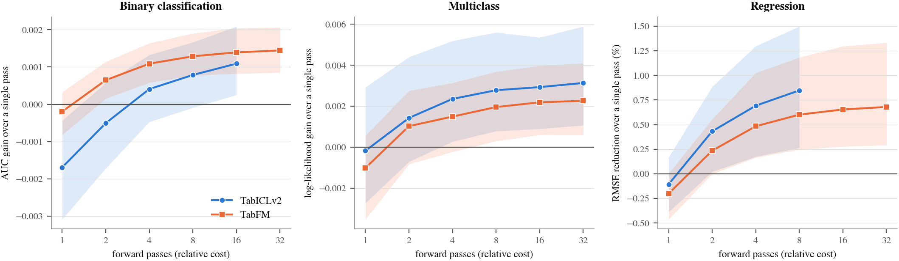

Tabular foundation models (TFMs) look like they make one forward pass: you give them a training table and a few query rows, and they predict. In practice they don't. Default configurations of TFMs such as TabICLv2, TabFM, TabPFNv3 and Mitra each run the model several times on perturbed copies of your training data and average the answers. The perturbations are things like shuffling the columns, shuffling the class labels, or changing the preprocessing (e.g., using different feature normalization techniques).
 

::::: {.columns}

:::: {.column width="45%"}
**TabICLv2**
```python
clf = TabICLClassifier()
clf.fit(X_train, y_train)          # no weights are updated
proba = clf.predict_proba(X_test)  # 1 call = 8 forward passes

# The defaults, written out
clf = TabICLClassifier(
    n_estimators=8,                  # 8 perturbed views
    feat_shuffle_method="latin",     # column shuffling
    class_shuffle_method="shift",    # class shuffling
    norm_methods=["none", "power"],  # preprocessing
)
```
::::

::: {.column width="10%"}
<!-- Leave this completely empty to act as your spacer -->
:::

:::: {.column width="45%"}
**TabFM**
```python
clf = TabFMClassifier(model)
clf.fit(X_train, y_train)          # no weights are updated
proba = clf.predict_proba(X_test)  # 1 call = 32 forward passes

# The defaults, written out
clf = TabFMClassifier(model,
    n_estimators=32,                 # 32 perturbed views
    feat_shuffle_method="random",    # column shuffling
    class_shift=True,                # class shuffling
    norm_methods=["none", "power"],  # preprocessing
)
```
::::

::::: 

The code on the left and right is the whole API: `fit`, then `predict`. Nothing in it mentions an ensemble. But with the default settings, a single `predict` call runs the network once per ensemble member (8 for TabICLv2, 32 for TabFM). Each member sees a different version of your table: the columns in a different order, the class labels shifted, and one of the preprocessing options (no normalization or a power transform). The final prediction is the average over members. What looks like one forward pass is really 8 or 32, and the second block in each snippet spells out the settings that were applied silently. The default budgets differ (8 members for TabICLv2, 32 for TabFM); in the experiments below I evaluate up to 32 members for both.

This ensemble ships as a default and is rarely ablated. I wanted to know what it actually does, so I opened up the two strongest open models I could instrument, TabICLv2 and TabFM, and ran them on all 51 [TabArena](https://tabarena.ai/) datasets (30 binary, 8 multiclass, 13 regression). 

:::{.callout-note} 
# TL;DR
The ensemble helps reliably, but the gain is tiny, and the leaderboard scale we use to report it makes it look much bigger than it is. That is a far smaller payoff than ensembling gives tree-based models or deep ensembles of neural networks, which suggests that ensembling for TFMs needs to be rethought.
:::


## What I did

I modified the inference loop of each model so that every ensemble member's prediction is cached. After that, the number of members, which perturbations are included and how members are averaged are all cheap post-hoc operations. About 48,000 cached cells later, I could ask questions that would otherwise cost a GPU run each.

I use two scales throughout:

- **Elo Rating**, computed the way TabArena does it (pairwise wins across datasets and splits). Mine is *local*: it comes from a pool of my own configurations, not the official leaderboard pool.
- **Effect size** in the task's own metric: AUC for binary, log-likelihood for multiclass, relative RMSE reduction for regression, with a paired Wilcoxon test over datasets.

## 1. The ensemble earns a lot of Elo for very little accuracy

Against a single forward pass, the shipped ensembles earn between 168 and 230 Elo. In the task's own metric, that is (@tbl-effect):

| Task | Gain from the shipped ensemble |
|---|---|
| Binary | about 0.001 AUC (0.0012 for TabICLv2, 0.0014 for TabFM) |
| Multiclass | 0.002 to 0.003 log-likelihood |
| Regression | 0.7% to 0.9% lower RMSE |

: Effect of the shipped ensemble versus a single forward pass. {#tbl-effect tbl-colwidths="[15,50]" .bordered}

The gain is real and consistent. TabFM's ensemble beats a single pass on 27 of 30 binary datasets, and on all 13 regression datasets. But a thousandth of AUC is a thousandth of AUC.

{#fig-gap fig-alt="Scatter plots of Elo gain against effect size for binary, multiclass and regression tasks; all configurations fall on one monotone curve."}

@fig-gap puts every configuration on both scales. They all fall on one monotone curve, and it is steep. A method that wins by a small margin on most datasets earns a large Elo. Elo tells you the ensemble helps *consistently*. It does not tell you how much. I would read it as a statement about consistency and report an effect size next to it.


:::{.callout-important} 
My Elo pool contains many near-copies of each other, which probably amplifies the effect. I haven't computed Elo against the official TabArena pool yet, and I expect the curve to be flatter there.
:::

## 2. The 32 members are almost one member

The shipped ensembles average 32 members (fewer for TabICLv2 on some tasks). I measured how many *independent* predictions that is, using the participation ratio of the members' error correlation. The median pool carries between 1.0 and 1.2 effective members.

So the members are close to copies of each other. Perturbing the input of a frozen network barely changes what it believes. That fits the size of the gains above.

Most of the gain also arrives early. **A single perturbed member is actually *worse* than the unperturbed pass, so the ensemble first has to recover its own damage**. After that, returns diminish quickly (@fig-cost). I count cost in forward passes: 32 members means 32 times the model evaluations of a single pass, and wall-clock time depends on the implementation.

{#fig-cost fig-alt="Line plots of effect size over a single pass against the number of forward passes. Gains rise over the first four to eight passes and then flatten for both models and all three task types."}

Take TabFM on binary tasks. One member scores about 0.0002 AUC *below* the single pass. Four members give +0.0011, eight give +0.0013, and 32 give +0.0014. **Going from 8 to 32 members quadruples the cost and adds about 0.00016 AUC**. On regression the pattern is the same: 0.60% lower RMSE at 8 members and 0.68% at 32. In Elo terms, 8 members reach 78% to 84% of the 32-member gain for TabFM, and 16 members reach 89% to 94% (@fig-members).

{#fig-members fig-alt="Line plots of Elo gain over a single pass as the number of ensemble members grows, for TabICLv2 and TabFM across task types."}

## 3. Column shuffling, class shuffling and preprocessing explain the gain

The shipped recipes mix three perturbations: column shuffling, class shuffling and preprocessing. I decomposed the gain over them with Shapley values, and I also tried the full product of all three instead of the shipped mix.

On binary and regression tasks, the full product is no better than the shipped mix. The only possible exception is multiclass TabICLv2 (+0.003 log-likelihood, improving 7 of 8 datasets), but with 8 datasets the test gives p = 0.078, so I don't count it as established. **Which axis matters most depends on the model and the task: preprocessing carries about half the multiclass gain for TabICLv2, while class shuffling matters most for TabFM.** I wouldn't expect that ordering to transfer.

## 4. Giving each member less of the table never helps

Classical ensemble methods such as, bagging and random forests give each member only part of the table: a random subset of rows, or a random subset of columns. The hope is that each member will learn something different, and averaging will reduce variance. I tested these tricks on top of the shipped recipe: 

- **Keep half of the columns per member:** −0.0045 AUC (TabICLv2) and −0.0048 (TabFM) on binary tasks, p < 0.001.
- **Keep half of the rows per member:** −0.0025 and −0.0022 AUC, p < 0.001.
- **Keep 90%:** neutral on classification. On regression, keeping 90% of the rows still makes RMSE slightly worse (0.4% for TabICLv2, 0.3% for TabFM, p < 0.01).

I did not find a setting where withholding information beats the shipped recipe. This suggests that the ensemble's gain comes from averaging over perturbations, not from decorrelating independent fits. The members are too similar to each other for subsampling to help, **in fact the model is frozen and does not realy learn anything substantially different from the other members.** The ensemble is a variance-reduction step, not a way to add new information.

### But what about round-robin subsampling?

Some wrappers deal columns out round-robin, with the argument that every column is then seen by some member. That sounds like it should fix the information loss, so I tested it directly against random draws at the same budget (TabICLv2, 16 members, half the columns each).

It doesn't. Round-robin gains +0.0007 AUC over random draws (p = 0.16), which is within noise, and it stays 0.0028 AUC *below* a single full-table pass. The reason is that coverage was never the problem: with 16 members and half the columns each, the chance that a given column is missed by every member is about 1.5 in 100,000. What hurts is what each member *cannot see*, not which columns the ensemble misses.

Coverage only starts to matter when members keep almost everything. On binary tasks, leave-one-fold-out partitions that drop 12.5% of the columns per member match the shipped ensemble within noise. I only ran these designs for TabICLv2 at half the columns, so treat the round-robin result as specific to that setting.

## 5. Two additions that behave differently

- **Relabelling categorical codes per member** is a good example of the Elo gap. For TabICLv2 it earns +92 Elo on binary tasks, and the effect size is 0.0004 AUC with p = 0.15. A decent rating, and nothing measurable behind it.
- **Appending extra features (SVD projections, crosses) to TabFM** does help on multiclass and regression tasks: +0.0010 log-likelihood on all 8 multiclass datasets (p = 0.008) and a 0.5% RMSE reduction on regression (p = 0.021). On binary tasks it does nothing. I don't know why binary differs.

Aggregation also matters. TabFM's extended configuration adds feature expansion, probability pooling and calibration. On multiclass tasks most of its gain comes from the pooling and calibration, not from the members.

## What this means for ensembling TFMs

For classical models, ensembling is one of the most reliable ways to buy accuracy. Bagging and random forests average trees fit on different resamples of the data, and deep ensembles average networks trained from different initialisations. Each member is a genuinely different fit, so their errors are only partly correlated, and averaging removes a lot of variance. Those are well-established results, and I did not rerun them here.

A TFM ensemble is a different animal. Every member is the same frozen network, reading the same table in a slightly different presentation. Nothing is refit, so there is no independent fit to average. The results above are what you would expect from that: members that are close to copies of each other (about one effective member out of 32), and a gain of roughly a $10^{-3}$ of AUC. The ensemble works as a small variance-reduction step. It does not add new information.

I think this calls for rethinking ensembling for TFMs, rather than copying the recipes from trees and neural networks:

1. **Don't import the classical recipe as is.** Shuffling and re-preprocessing the input is cheap, but it is not where the diversity of a tree or deep ensemble comes from, and it shouldn't be expected to give similar gains.
2. **Treat withholding information as a poor source of diversity.** Subsampling columns or rows is the standard way to decorrelate bagged models. For a frozen TFM, the information each member loses costs more than the diversity it adds.
3. **Look at the other levers.** Adding features helped in some tasks, and pooling and calibration mattered more than the members in others. Sources of diversity that go beyond one frozen network, such as different checkpoints or different models, are the obvious next thing to test. I haven't tested them here.
4. **Report an effect size next to Elo.** Elo says whether an ensemble wins consistently. It doesn't say by how much, and for TFMs the gap between those two is large.
5. **Automate the choice of perturbations.** Which preprocessing and which combination of perturbation axes works best depends on the dataset. TabFM-auto does this automatically: it uses LLM agents to find the best preprocessor for a given dataset, along with the best perturbation-axis combination.

