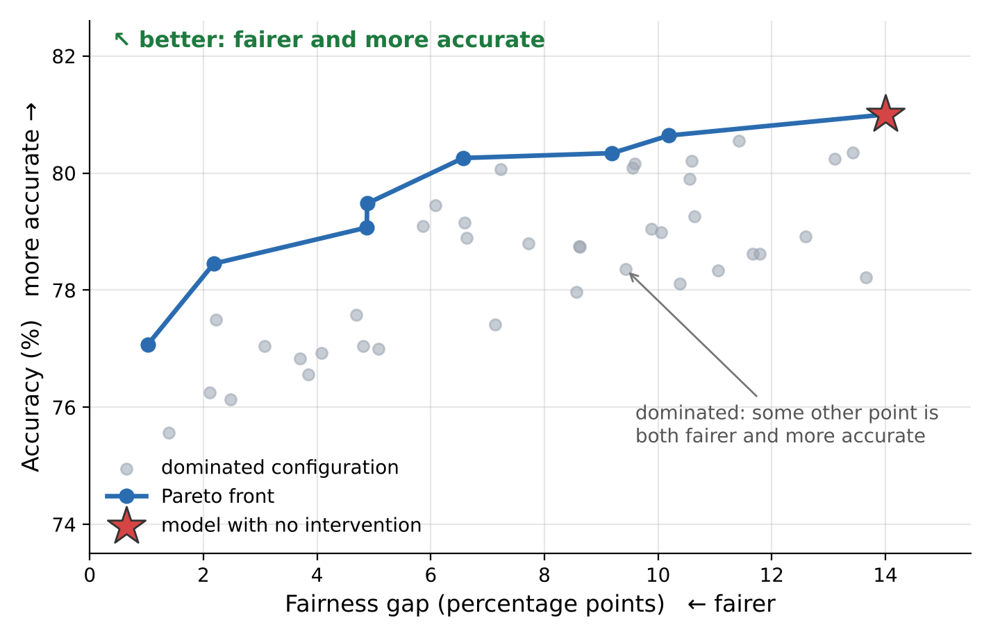
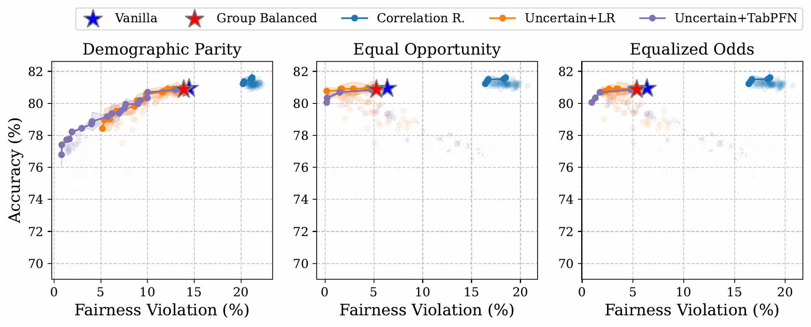
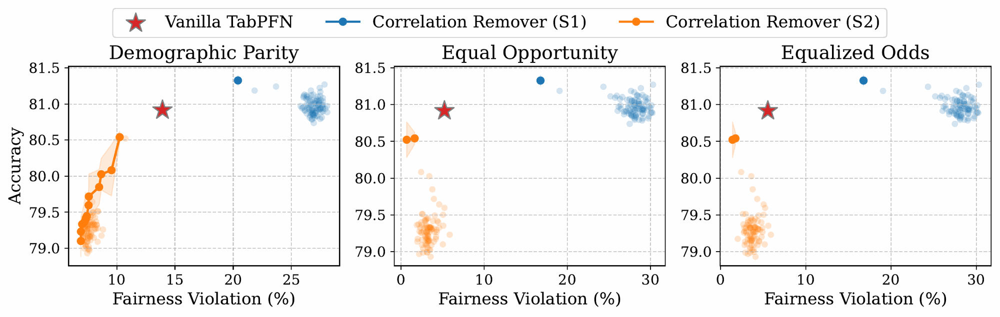
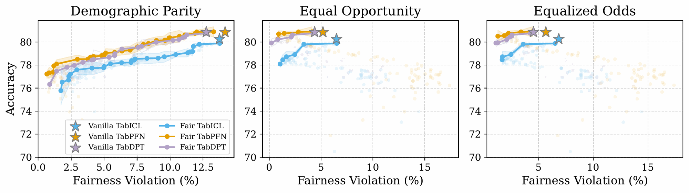

Tabular foundation models (TFMs) such as [TabPFN](https://github.com/PriorLabs/TabPFN), [TabICL](https://github.com/soda-inria/tabicl) and [TabDPT](https://github.com/layer6ai-labs/TabDPT-inference) don't train on your data. You pass your labelled rows in as *context*, and the model predicts the labels of new rows in a single forward pass. Its weights never change.

That is convenient, and it is a problem for fairness. Most bias-mitigation methods need a training loop: they add a fairness penalty to the loss, reweight the training examples, or train an adversary. A TFM has no training loop on your data. **The only thing you control is the context.**

So in [*Towards Fair In-Context Learning with Tabular Foundation Models*](https://openreview.net/forum?id=AsBhwD0sqo) (TMLR 2026, with Samira Ebrahimi Kahou and Ulrich Aïvodji), we asked a simple question: can choosing or transforming the context rows make a TFM's predictions fairer?

:::{.callout-note}
# TL;DR
Yes, but not in the obvious ways. Removing correlations with the sensitive attribute made predictions *less* fair, and balancing the groups in the context barely changed anything. What worked was keeping only the context rows whose sensitive attribute is hard to guess.
:::

## The setup

The running example throughout this post is **ACSIncome**, a task from the [folktables](https://github.com/socialfoundations/folktables) library, which builds prediction tasks from US Census data (the American Community Survey). The goal is to predict whether a person earns more than \$50,000 a year, among people over 16 who worked at least one hour a week in the past year and earned at least \$100. The sensitive attribute is sex, and we use the 2018 data for Alabama, one of the states with the largest fairness gaps in folktables. The paper repeats every experiment on seven more datasets (four more folktables tasks, Diabetes, German Credit and CelebA) with TabPFNv2, TabICL and TabDPT, and the conclusions hold across them.

We measure fairness with three group metrics, each reported as a gap between groups in percentage points (0 means parity):

- **Demographic parity (DP):** do women and men get positive predictions at the same rate?
- **Equal opportunity (EOP):** among people who truly earn more than \$50,000, are women and men recognised at the same rate?
- **Equalized odds (EOD):** are both the true-positive and false-positive rates equal across the two groups?

Out of the box, TFMs are not fair. On ACSIncome, TabPFNv2 reaches about 81% accuracy with a demographic-parity gap of about 14 points: it predicts "earns more than \$50,000" for one sex 14 points more often than for the other.

## Three ways to build a fairer context

We tried three pre-processing interventions. All three change only the context, so they work with any TFM without retraining it.

1. **Correlation removal.** Transform the features so they are no longer linearly correlated with the sensitive attribute. This is a classic method, available in [Fairlearn](https://fairlearn.org) as [`CorrelationRemover`](https://fairlearn.org/main/api_reference/generated/fairlearn.preprocessing.CorrelationRemover.html). The standard recipe transforms both the context and the test rows, and a parameter $\alpha$ sets how much correlation to remove.
2. **Group-balanced context.** Sample the context so women and men contribute the same number of rows.
3. **Uncertainty-based context (ours).** Train a small classifier to predict sex from the other features, then keep in the context only the rows where that classifier is *unsure*.

The third method needs a word on "unsure". We use [conformal prediction](https://arxiv.org/abs/2107.07511) (through the [MAPIE](https://github.com/scikit-learn-contrib/MAPIE) library). Instead of a single guess, a conformal predictor returns a *set* of plausible groups, with a guarantee that the true group is in the set at least $1-\epsilon$ of the time. A row whose set contains both groups is one where the features don't give the person's sex away, and those are the rows we keep. The coverage parameter $\epsilon$ becomes a dial: the smaller it is, the stricter the selection. We tried two classifiers for this step, a logistic regression and TabPFN itself.

The intuition: a TFM picks up bias from the context by learning how the features that reveal sex relate to income. **If the context rows don't reveal sex, there's much less of that shortcut to learn.**

## How to read the plots

Every result below is a **fairness–accuracy plot** (@fig-howto). Each dot is one configuration: one method at one setting of its parameter, averaged over three random splits of the data. Accuracy is on the vertical axis (higher is better) and the fairness gap is on the horizontal axis (lower is better), so **the best place to be is the top-left corner.**

{#fig-howto width="80%" fig-alt="Schematic scatter plot of accuracy against fairness gap, with a Pareto front line running from a red star at the top right towards the left, and grey dominated points below it."}

Fairness and accuracy usually pull against each other, so there is rarely a single best configuration. Instead, we look for configurations that can't be beaten on both at once:

- A configuration is **dominated** if some other configuration is both fairer *and* at least as accurate. There's no reason to ever pick it.
- The configurations that aren't dominated form the **Pareto front**: the line of best available trade-offs. Moving along the front, you can only gain fairness by giving up some accuracy, and the other way round.
- A method with a parameter ($\epsilon$, $\alpha$) traces its own front as the parameter varies. A method with no parameter, like the unmodified model or the group-balanced context, is a single point, drawn as a star.

To compare two methods, compare their fronts. **If one front lies above and to the left of another, that method gives a better trade-off at every level of fairness.** In the paper's plots, faded dots are dominated configurations and solid lines with bold markers are each method's front. There are three panels per figure, one per fairness metric.

## What we found

### Picking uncertain rows works; the other two don't

@fig-tradeoff shows all five approaches on ACSIncome with TabPFN.

{#fig-tradeoff .column-page-right fig-alt="Three panels of accuracy against fairness violation for demographic parity, equal opportunity and equalized odds. Uncertainty-based selection curves run left from the unmodified model; correlation removal sits far to the right at much higher violation."}

Start with the blue star, the unmodified model: about 81% accuracy and a 14-point demographic-parity gap. Then look at each method relative to it.

- **Uncertainty-based selection (purple and orange lines) is the only method whose front extends to the left of the star.** As $\epsilon$ shrinks, the front moves from the star down and to the left, reaching a gap of about 1 point at about 77% accuracy. Every point along that line is a trade-off you can pick by setting $\epsilon$. In the equal-opportunity and equalized-odds panels, the fronts are nearly flat: the gap falls from about 6 points to about 1 point or less, while accuracy drops by about one point.
- **Using TabPFN to measure uncertainty (purple) beats logistic regression (orange).** In the demographic-parity panel, the purple front goes further left than the orange one.
- **Group balancing (red star) lands almost on top of the unmodified model.** On ACSIncome that's partly expected, since the data are already nearly balanced by sex (about 52% women). But in the paper, balancing barely helps even where it changes the context a lot, which suggests the bias isn't just about who is under-represented.
- **Correlation removal (the blue cluster on the far right) is dominated by the unmodified model itself.** It keeps the accuracy but pushes the demographic-parity gap from about 14 points to more than 20. Applying it is strictly worse than doing nothing.

### Why correlation removal backfires

To understand the last result, we asked the TFM itself to predict the sensitive attribute in context. On the raw ACSIncome features, TabPFN recovers a person's sex with 77% accuracy. **After correlation removal, it recovers it with 100% accuracy.** The transformation modifies every feature using the sensitive attribute, and the model learns to read that signal back out. Instead of hiding sex, correlation removal hands the model a perfect proxy for it, and the model uses it.

The fix is simple: transform only the context rows and leave the test rows alone. Reconstruction accuracy then drops to 54%, close to a coin flip. @fig-cr shows what that does to the trade-off.

{#fig-cr .column-page-right fig-alt="Three panels of accuracy against fairness violation. Blue S1 points sit far to the right of the unmodified model; the orange S2 front sits to its left."}

The standard recipe (S1, blue) sits far to the right of the star in every panel: much less fair, for no real gain in accuracy. The fixed version (S2, orange) forms a front to the *left* of the star, so it improves fairness for less than two points of accuracy. Same method, opposite result, just from not touching the test rows.

By comparison, uncertainty-based selection with TabPFN brings reconstruction accuracy on ACSIncome down to 51%. The context it selects says almost nothing about the sensitive attribute, which is exactly the point.

### Does the choice of TFM matter?

@fig-models runs uncertainty-based selection with three different TFMs on ACSIncome.

{#fig-models .column-page-right fig-alt="Three panels of accuracy against fairness violation with fronts for TabICL, TabPFN and TabDPT; TabPFN and TabDPT fronts lie above TabICL."}

Without intervention (the stars), the three models sit close together, with gaps of 13 to 14 points in demographic parity. TabDPT, which is pretrained on real data, is not more biased than the two models pretrained on synthetic data. With the intervention, **all three fronts reach small gaps**, so the method works regardless of the model. The fronts of TabPFN (orange) and TabDPT (purple) lie above TabICL's (blue): at the same level of fairness, they are about one point more accurate.

One more result from the paper: a larger context improves accuracy, but unfairness levels off once the context has about 700 rows. **More data in the context doesn't fix bias on its own.**

## Takeaways

- **Check fairness when you use a TFM.** Its accuracy doesn't come with fairness built in.
- **Don't apply correlation removal to your test rows.** With a TFM, it leaks the sensitive attribute and amplifies bias. Transform the context only, if you use it at all.
- **Try uncertainty-based context selection.** It works with any TFM, needs no retraining, and gives you one parameter to set the trade-off.

It has limits. You need the sensitive attribute for the context rows (though not for the person being scored), dropping rows costs some accuracy, and $\epsilon$ has to be tuned for each task. That raises the obvious next question: can the model learn fairness during pretraining instead, so none of this is needed? That's the subject of my next post.

## Paper and code

**Towards Fair In-Context Learning with Tabular Foundation Models.** Patrik Kenfack, Samira Ebrahimi Kahou, Ulrich Aïvodji. *Transactions on Machine Learning Research*, 2026. [Paper](https://openreview.net/forum?id=AsBhwD0sqo) · [Code](https://github.com/tisl-lab/FairTabICL) · [Talk](https://youtu.be/dLMC1IbR4LA) · [BibTeX](#citation)

## Citation {.appendix}

If you use this work, please cite the paper:

```bibtex
@article{kenfack2026towards,
  title={Towards Fair In-Context Learning with Tabular Foundation Models},
  author={Patrik Kenfack and Samira Ebrahimi Kahou and Ulrich A{\"\i}vodji},
  journal={Transactions on Machine Learning Research},
  issn={2835-8856},
  year={2026},
  url={https://openreview.net/forum?id=AsBhwD0sqo}
}
```
