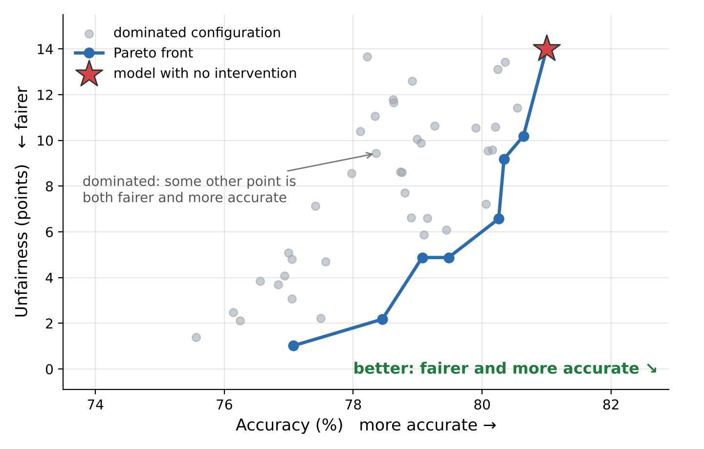
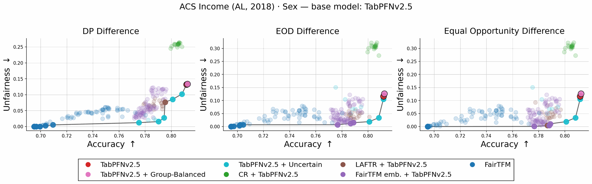

A tabular foundation model (TFM) such as [TabPFN](https://github.com/PriorLabs/TabPFN) or [TabICL](https://github.com/soda-inria/tabicl) makes predictions **without training on your data**. You hand it your labelled rows as *context*, and it predicts the labels of new rows in a forward pass. Most fairness methods need a training loop to plug into, and a TFM doesn't have one. So where can you intervene? In two earlier posts, I described the two places that are left:

1. **Fix the context** ([post](../fair-in-context-learning/index.qmd), based on our [TMLR 2026 paper](https://openreview.net/forum?id=AsBhwD0sqo)). The context is the only thing you control at inference time. Keeping only the context rows whose sensitive attribute is hard to guess made predictions fairer, while the classic correlation removal made them worse.
2. **Fix the model** ([post](../training-fair-tabular-foundation-models/index.qmd), based on our [ICML 2026 workshop paper](https://arxiv.org/abs/2608.14211)). FairTFM builds fairness into pretraining with synthetic fairness tasks and an adversarial head, so it makes fairer predictions in a single forward pass.

The two papers were evaluated separately, on different benchmarks and against different baselines. This post runs both on the same 27 tasks and puts them on one fairness–accuracy Pareto front, to see what each approach buys and where each falls short.

:::{.callout-note}
# TL;DR
Out of the box, TFMs are the most accurate models in the comparison and among the least fair. Two classical fixes, removing correlations and balancing groups in the context, don't help (correlation removal makes things worse). **Picking context rows whose sensitive attribute is hard to infer is the one cheap fix that works:** within a two-point accuracy budget it lowers the demographic-parity gap on 20 of 24 tasks. Training fairness into the model (FairTFM) goes further on some tasks, but in this run its predictions often collapse to a single class, which I discuss openly below.
:::

::: {.key-numbers}
::: {.kn .kn-setup}
[9.1 pts]{.kn-value}
[demographic-parity gap of TabPFNv2.5, averaged over 27 tasks]{.kn-label}
:::
::: {.kn .kn-real}
[5 / 27]{.kn-value}
[tasks where correlation removal lowers that gap]{.kn-label}
:::
::: {.kn .kn-looks}
[20 / 24]{.kn-value}
[tasks where uncertainty-based context lowers it]{.kn-label}
:::
::: {.kn .kn-looks}
[−29% / −38%]{.kn-value}
[median gap reduction for TabPFNv2.5 / TabICLv2]{.kn-label}
:::
:::

## How I measure fairness

Every task has a binary label $y$ and a sensitive attribute $s$ (sex, age group, race, …). I report three group-fairness gaps, all in percentage points, where 0 means parity:[^metrics]

- **Demographic parity (DP):** do the groups receive positive predictions at the same rate?
- **Equal opportunity (EOP):** among people whose true label is positive, are the groups recognised at the same rate (equal true-positive rates)?
- **Equalized odds (EOD):** are both the true-positive *and* the false-positive rates equal across groups?

A model can always reach a zero gap by predicting the same label for everyone, so a gap only means something next to accuracy. That is why everything below is a fairness–accuracy *trade-off*, and why I'll come back to constant predictions at the end.

## How to read the plots

All the plots below are **fairness–accuracy plots** with **accuracy on the horizontal axis and unfairness on the vertical axis**, so the best place to be is the **bottom-right corner** (@fig-howto). Each dot is one configuration: one model with one intervention at one setting of its parameter.

{#fig-howto width="80%" fig-alt="Schematic scatter plot of unfairness against accuracy, with a Pareto front line running from a red star at the top right down towards the bottom left, and grey dominated points above it."}

A configuration is **dominated** if another one is both fairer *and* at least as accurate. The configurations that aren't dominated form the **Pareto front** (the black line): the best trade-offs available. Moving along the front, you can only gain fairness by giving up accuracy. The [FairTFM post](../training-fair-tabular-foundation-models/index.qmd#how-to-read-the-results) has a longer explanation.

## Both approaches on one Pareto front

For this post, I ran the context interventions from the first paper, FairTFM from the second, and two extra baselines on the same benchmark.

**Tasks.** 27 tasks in total: the five [folktables](https://github.com/socialfoundations/folktables) tasks (ACSIncome, ACSEmployment, ACSMobility, ACSPublicCoverage and ACSTravelTime; Alabama, 2018) with sex, age and race as the sensitive attribute, plus Adult, German Credit, COMPAS, LSAC, Diabetes and CelebA (12 tasks). Non-ACS datasets are subsampled to 7,000 training and 3,000 test rows. There is one run per configuration.

**Base models.** TabICLv2, TabPFNv2.5, and FairTFM models pretrained with $\lambda \in \{0.1, 0.7, 10, 25\}$. The plots also include "FairTFM-0.1 (scaled)", a larger FairTFM with $\lambda = 0.1$: 12 layers and 12 attention heads instead of 6 and 6, pretrained for longer.

**Interventions.** On each base model: nothing, group-balanced context, uncertainty-based context (swept over $\epsilon$), correlation removal ([Fairlearn's `CorrelationRemover`](https://fairlearn.org/main/api_reference/generated/fairlearn.preprocessing.CorrelationRemover.html), swept over its strength), and [LAFTR](https://arxiv.org/abs/1802.06309) features (an adversarially trained fair representation, swept over its adversarial weight, with the adversary matched to each metric). I also fed FairTFM's embeddings to TabICLv2 and TabPFNv2.5 as features, and ran FairTFM end to end at every saved checkpoint.

{#fig-front .column-page-right fig-alt="Three scatter plots of unfairness against accuracy for DP, EOD and equal opportunity differences, averaged over 27 tasks, with a Pareto front from the unconstrained TabPFN at top right down to FairTFM at bottom left."}

@fig-front is busy, so here is what it says, one intervention at a time.

### Out of the box, TFMs are accurate and unfair

Averaged over the 27 tasks, TabPFNv2.5 reaches 78.9% accuracy with gaps of 9.1 (DP), 12.2 (EOD) and 10.1 (EOP) points. TabICLv2 is nearly identical (78.8%; 9.6, 12.4 and 10.4). Both anchor the top-right end of the front: **no configuration beats them on accuracy, and most are fairer.**

### Correlation removal and group balancing don't help

The green cloud in the top-right corner of @fig-front is correlation removal. It keeps the accuracy, but **it raises every gap**: with TabICLv2, DP goes from 9.6 to between 11.7 and 14.8 points depending on the strength. Per task, if I allow at most two points of accuracy loss and pick the best strength, CR lowers the DP gap on only 5 of 27 tasks for TabPFNv2.5 (8 for TabICLv2), and the median task gets 28% *worse*. This is what the [first post](../fair-in-context-learning/index.qmd) found on ACSIncome, now across 27 tasks.

Group balancing (pink) barely moves: DP goes from 9.1 to 9.3 for TabPFNv2.5, and per task it helps about as often as it hurts (median change −1%).

### Uncertainty-based context is the cheap fix that works

Of the three context interventions from the first paper, uncertainty-based selection (cyan) is the only one that consistently moves the TFMs towards lower unfairness. (LAFTR, in brown, also helps a little, with DP gaps of 7.4 to 9.3 points for a 2.3 to 3.3-point accuracy loss, but it needs an adversarial encoder trained for every task.) With the same two-point accuracy budget:

| Base model | DP gap lowered on | Median DP change | EOP gap lowered on | Median EOP change |
|:---|:---:|:---:|:---:|:---:|
| TabPFNv2.5 | 20 / 24 tasks | −29% | 22 / 24 tasks | −37% |
| TabICLv2 | 22 / 26 tasks | −38% | 20 / 26 tasks | −44% |

: Uncertainty-based context selection versus the unmodified model, per task, choosing the best $\epsilon$ that loses at most two points of accuracy. The remaining tasks have no $\epsilon$ within that budget. {#tbl-unc tbl-colwidths="[22,20,18,22,18]"}

On individual tasks the effect can be large. On ACSIncome with sex as the sensitive attribute (@fig-acs), TabPFNv2.5's DP gap drops from 13.2 to 2.0 points (at $\epsilon = 0.1$) while accuracy goes from 81.2% to 78.8%. The EOP gap drops from 11.6 to 1.9 points (at $\epsilon = 0.05$) for a 1.1-point accuracy loss.

{#fig-acs .column-page-right fig-alt="Three scatter plots of unfairness against accuracy for one task. Uncertainty-based points form a front leading down and left from the unmodified TabPFN; correlation-removal points sit above it at much higher unfairness."}

Two practical caveats. First, **the best $\epsilon$ depends on the metric:** on that task, the $\epsilon$ that minimises the DP gap is not the one that minimises the EOP gap, and the response to $\epsilon$ is not monotone. Tune it on validation data for the metric you care about. Second, the method works by *dropping* context rows (from 3,258 to 1,300 at $\epsilon = 0.1$ on ACSIncome), so on small datasets it has less room to work with.

### FairTFM's embeddings don't carry the fairness over

One natural shortcut would be to use FairTFM as a fair feature extractor and let a stronger TFM do the predicting. It doesn't work: TabICLv2 and TabPFNv2.5 on FairTFM embeddings (purple) have DP gaps of 9.0 to 10.7 points, no better than the raw features, and they lose 1.5 to 5 points of accuracy. **Whatever FairTFM learns about fairness doesn't transfer through its embeddings to another model.**

### FairTFM, and a caveat about constant predictions

FairTFM's end-to-end checkpoints (blue) cover the low-unfairness end of @fig-front, and $\lambda$ behaves like the trade-off dial it is designed to be: the median DP gap across checkpoints falls from 4.6 points at $\lambda = 0.1$ to 2.6 points at $\lambda = 25$, while median accuracy falls from 73.7% to 70.5%.

:::{.callout-important}
# Read the low end of the front with care
On many tasks, FairTFM's thresholded predictions in this run are **constant**: every test row gets the majority class, so all three gaps are exactly zero and accuracy equals the majority-class rate. That is the case for 62% of all FairTFM checkpoint–task evaluations, and for the final $\lambda = 10$ model on 17 of 27 tasks. The lowest-unfairness point in @fig-front is constant on 21 of its 27 tasks. The scores still carry signal (mean ROC-AUC of 0.73 to 0.77 across $\lambda$, against 0.81 for TabPFNv2.5), so the collapse happens at the decision threshold, not in the ranking.
:::

On the tasks where FairTFM's predictions are *not* constant, the gain is real but smaller than the averages suggest. With $\lambda = 10$ (10 tasks), the DP gap is 8.0 points against 16.5 for TabPFNv2.5 on the same tasks, at 74.7% versus 81.1% accuracy. With $\lambda = 0.7$ (13 tasks), it is 10.9 against 14.0 points, at 78.5% versus 81.8%.

The representations tell the same story (@fig-tsne). On ACSIncome with sex as the sensitive attribute, the sensitive groups are completely mixed in FairTFM's representation (silhouette 0.000 for $\lambda = 10$, against 0.017 for the raw features), while the labels separate better than in the raw features (0.146 against 0.067). For $\lambda \geq 0.7$ the whole test set also collapses onto a thin curve: **the adversary removes the sensitive attribute, and much of the spread with it.** On this particular task the predictions stay informative: the final $\lambda = 10$ model has a DP gap of 2.6 points (TabPFNv2.5: 13.2) at 72.3% accuracy (TabPFNv2.5: 81.2%).

{#fig-tsne .column-page fig-alt="Grid of t-SNE plots. Raw and baseline representations form diffuse clouds; FairTFM with lambda 0.7 and above collapses into thin curves, with the two sexes fully mixed and the two labels at opposite ends."}

So the honest summary of this run is: **FairTFM does remove the sensitive attribute from its representation, and $\lambda$ controls how much, but at the default threshold that often costs the decision boundary.** The FairTFM paper finds the same effect for its highest fairness weight, and shows that it is a calibration issue rather than a loss of signal: on ACSIncome, setting the threshold so the model predicts positives at the base rate raises the accuracy of FairTFM with $\lambda = 25$ from 70.7% to 77.7%, with gaps still about half those of TabPFNv2.5 (see the caveat in the [FairTFM post](../training-fair-tabular-foundation-models/index.qmd#what-else-we-checked)). Choosing the threshold on validation data is the obvious fix to apply to this run too.

## Which one should you use?

| Your situation | What I'd use |
|:---|:---|
| You use an off-the-shelf TFM and want fairer predictions without retraining | Uncertainty-based context selection; tune $\epsilon$ on validation data for your metric |
| You want the fairness trade-off built into the model itself | FairTFM, choosing $\lambda$ for the trade-off you need, and checking that predictions aren't constant at your decision threshold |
| You were going to apply correlation removal | Don't, at least not to both context and test rows. It leaks the sensitive attribute |
| You were going to balance the groups in the context | Expect little effect on its own |

: Practical guidance from both papers. {#tbl-guide tbl-colwidths="[45,55]"}

Both approaches share one useful property: **neither needs the sensitive attribute of the person being scored.** The flip side is that both need it for every context row, and that isn't always available.

## Explore the results

Averages hide a lot of variation across tasks. The [interactive explorer](explorer/index.html){target="_blank"} has every Pareto front from this comparison: all 27 tasks, every base model, accuracy or ROC-AUC, plus the t-SNE plots and the averages over ACS and non-ACS tasks.

## Papers and code

- **Towards Fair In-Context Learning with Tabular Foundation Models.** Patrik Kenfack, Samira Ebrahimi Kahou, Ulrich Aïvodji. *TMLR*, 2026. [Paper](https://openreview.net/forum?id=AsBhwD0sqo) · [Code](https://github.com/tisl-lab/FairTabICL) · [Talk](https://youtu.be/dLMC1IbR4LA)
- **Training Fair Tabular Foundation Models.** Patrik Kenfack, Jesse C. Cresswell, Anthony L. Caterini, Samira Ebrahimi Kahou, Ulrich Aïvodji. *2nd ICML Workshop on Foundation Models for Structured Data*, 2026 (spotlight oral). [Paper](https://arxiv.org/abs/2608.14211) · [Code](https://github.com/patrikken/FairTFM-inference) · [Talk](https://icml.cc/virtual/2026/71496)

Blog posts: [fix the context](../fair-in-context-learning/index.qmd), [fix the model](../training-fair-tabular-foundation-models/index.qmd). BibTeX entries are on each paper's page: [paper 1](/papers/towards-fair-in-context-learning-with-tabular-foundation-models/), [paper 2](/papers/training-fair-tabular-foundation-models/).

[^metrics]: With groups $a$ and $b$: DP gap $= |P(\hat{y}=1 \mid s=a) - P(\hat{y}=1 \mid s=b)|$; EOP gap $= |P(\hat{y}=1 \mid y=1, s=a) - P(\hat{y}=1 \mid y=1, s=b)|$; the EOD gap is the larger of the true-positive-rate and false-positive-rate gaps. With more than two groups, I take the largest gap between any two groups.
