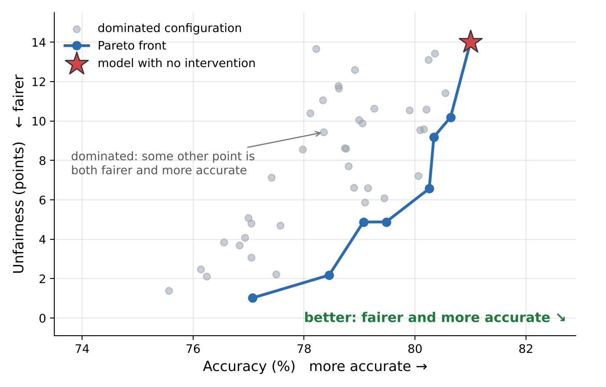
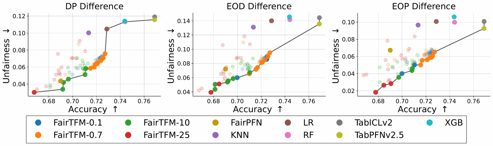
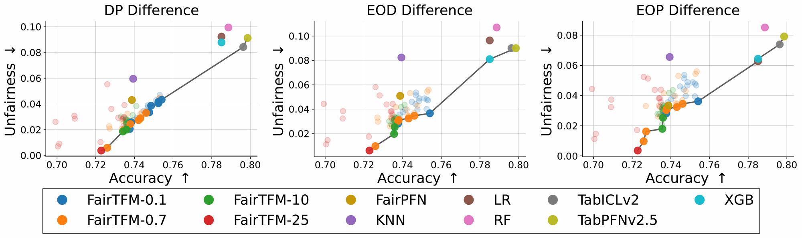

Imagine a bank that uses a tabular foundation model (TFM) to predict whether a client earns more than \$50,000 a year. Anti-discrimination law forbids disadvantaging clients by gender, so the bank needs those predictions to be fair. But an off-the-shelf TFM makes predictions without ever changing its weights. There is no training step where the bank could add a fairness constraint.

In the [previous post](../fair-in-context-learning/index.qmd), we worked around this by choosing the context rows carefully. That works, but it has to be tuned for every task, it throws away part of the context, and the model itself stays unchanged. This post is about the other option: **making fairness part of what the model learns during pretraining**, so the bank only has to mark gender as the sensitive attribute and get fairer predictions in one forward pass.

That is the idea behind FairTFM, from [*Training Fair Tabular Foundation Models*](https://arxiv.org/abs/2608.14211) (ICML 2026 Workshop on Foundation Models for Structured Data, spotlight oral), with Jesse Cresswell and Anthony Caterini from [Layer 6](https://layer6.ai/), Samira Ebrahimi Kahou and Ulrich Aïvodji.

:::{.callout-note}
# TL;DR
FairTFM is pretrained on synthetic fairness tasks, with a second head that tries to predict the sensitive attribute and a gradient reversal layer that stops the model from encoding it. Averaged over 120 folktables tasks, even the least constrained version cuts all three fairness gaps of TabPFNv2.5 by about a third, for about four points of accuracy, and larger fairness weights cut them by up to 75%. One knob, $\lambda$, sets the trade-off.
:::

## Two obstacles

Building fairness into a TFM runs into two problems.

1. **The pretraining data has no sensitive attributes.** TFMs such as [TabPFN](https://github.com/PriorLabs/TabPFN) and [TabICL](https://github.com/soda-inria/tabicl) are pretrained on millions of synthetic datasets drawn from a prior. None of them has a "gender" or "race" column.
2. **Standard fairness training assumes a fixed task.** An adversary or a fairness penalty is normally fitted to one dataset and one sensitive attribute. A TFM has to learn a *procedure* that works on tables it has never seen, whatever the sensitive attribute is.

## Idea 1: turn every pretraining dataset into a fairness task

For each synthetic dataset, we pick one feature at random, remove it from the features, and call it the sensitive attribute (@fig-tasks). If it is continuous, we cut it into groups using a random "stick-breaking" scheme, which gives groups of uneven, data-dependent sizes.

{#fig-tasks fig-alt="Pipeline diagram: a dataset prior produces a table X' and labels y; one column is selected, converted to a categorical sensitive attribute s by stick-breaking, and combined with the remaining features X and labels y into a fairness task."}

Every pretraining dataset becomes a fairness task, for free. Since any feature can be sensitive in one task and an ordinary feature in another, the model sees an enormous variety of ways in which a sensitive attribute can be tangled up with the label, and it can't learn to simply ignore a fixed column.

## Idea 2: an adversarial head with gradient reversal

The model reads triplets $(x, y, s)$ for the context rows, where $s$ is the sensitive attribute, instead of the usual pairs $(x, y)$. Each of the three inputs has its own encoder, and the shared transformer processes them together with the query rows (@fig-arch). On top of the transformer sit two heads: one predicts the label $y$ of each query row, and the other tries to predict its sensitive attribute $s$.

{#fig-arch width="85%" fig-alt="Architecture diagram: four input boxes feed encoders that join a Transformer block; two output heads produce y-hat and s-hat for the query; a blue arrow returns from the y head and a red arrow from the s head."}

The trick is a [gradient reversal layer](https://arxiv.org/abs/1409.7495) in front of the second head. The head itself learns to predict $s$ as well as it can. But the gradient flowing back into the transformer is flipped (the red arrow in @fig-arch), so the transformer is pushed to make $s$ *harder* to predict. The training objective is

$$
\mathcal{L} = \mathrm{CE}(\hat{y}, y) + \lambda \, \mathrm{CE}(\hat{s}, s),
$$

where CE is the cross-entropy loss and $\lambda$ sets how hard the model is pushed to hide $s$. A larger $\lambda$ gives a fairer but less accurate model.

One subtlety: the adversary doesn't see the query's label, so it pushes the representation to be independent of $s$ altogether. That targets demographic parity most directly, rather than equalized odds or equal opportunity, which only ask for independence *within* each label. This is deliberate. At pretraining time, nobody knows which task or which fairness definition the model will face, so we aim for a representation that does well on all three. As the results show, it reduces all three gaps.

Two details make this practical. Because the reversal works through gradients, there is no separate adversary to retrain for every pretraining task. And the query row's sensitive attribute is never given to the model: it is replaced by a learned placeholder. **You don't need the sensitive attribute of the person being scored**, only those of the context rows.

We built FairTFM on [nanoTabPFN](https://github.com/automl/nanoTabPFN), a small open reimplementation of TabPFN (6 layers, 6 attention heads, 192-dimensional embeddings), and pretrained it on 300,000 synthetic datasets from TabICL's prior. The small backbone is deliberate: it lets us compare against an identical model trained without the fairness components, so any difference comes from the fairness training alone. We trained four versions, with $\lambda = 0.1$, $0.7$, $10$ and $25$.

## How to read the results

The results are **fairness–accuracy plots** (@fig-howto). Each dot is one model, averaged over many tasks. Here **accuracy is on the horizontal axis and unfairness on the vertical axis**, so the best place to be is the **bottom-right corner**. (This is flipped compared with the plots in the previous post.)

{#fig-howto width="80%" fig-alt="Schematic scatter plot of unfairness against accuracy, with a Pareto front line running from a red star at the top right down towards the bottom left, and grey dominated points above it."}

- A model is **dominated** if some other model is both fairer *and* at least as accurate. There's no reason to ever pick it.
- The models that aren't dominated form the **Pareto front** (the black line in the real plots): the set of best available trade-offs. Along the front, you can only gain fairness by giving up some accuracy.
- For FairTFM, we plot several pretraining checkpoints for each value of $\lambda$, which traces out more of the front. Faded dots are dominated checkpoints; bold dots are on the front.

The three panels are three fairness gaps, each in the range 0 to 1, where 0 means parity: **demographic parity** (DP, do groups get positive predictions at the same rate?), **equalized odds** (EOD, are true- and false-positive rates equal?) and **equal opportunity** (EOP, are true-positive rates equal?).

## Results on 120 folktables tasks

We evaluated on 120 tasks from the [folktables](https://github.com/socialfoundations/folktables) library: five prediction problems from US Census data (including ACSIncome, the income question from the bank example), three sensitive attributes (sex, age and race), and eight US states. None of this data was seen during pretraining. We compared against logistic regression (LR), random forests (RF), XGBoost (XGB), k-nearest neighbours (KNN), TabPFNv2.5, TabICLv2, and [FairPFN](https://arxiv.org/abs/2506.07049), the only earlier TFM pretrained for fairness (it targets a causal notion of fairness rather than group gaps).

{#fig-main .column-page-right fig-alt="Three panels of unfairness against accuracy averaged over 120 tasks. TabPFNv2.5 and TabICLv2 sit at the top right; FairTFM checkpoints form most of the Pareto front down to the bottom left; FairPFN sits above the front."}

Here is how to read @fig-main, from right to left:

- **Top right: the unconstrained TFMs.** TabPFNv2.5 and TabICLv2 are the most accurate models, but they also have some of the largest gaps. They anchor the accurate end of the front.
- **Upper middle: the classical models.** XGBoost, random forests, logistic regression and KNN are less accurate than the TFMs and roughly as unfair. XGBoost and logistic regression make it onto the demographic-parity front, just below the TFMs. In the other two panels, all four are dominated: some FairTFM checkpoint is both fairer and at least as accurate.
- **The rest of the front: FairTFM.** Moving down and left along the front, you pass through FairTFM with $\lambda = 0.1$ and $0.7$, then 10, then 25. Each step buys a smaller gap for a bit of accuracy. **The front is nearly a straight line, and FairTFM fills most of it.**
- **FairPFN sits above the front.** It is fairer than the unconstrained models, but a FairTFM checkpoint beats it on both fairness and accuracy, and it offers a single operating point with no way to adjust the trade-off.

Exact numbers for the final checkpoint of each model, averaged over the 120 tasks and three seeds:

| Model | Accuracy | AUC | DP gap | EOD gap | EOP gap |
|:---|---:|---:|---:|---:|---:|
| TabPFNv2.5 | 0.770 | 0.801 | 0.121 | 0.145 | 0.098 |
| TabICLv2 | 0.771 | 0.802 | 0.120 | 0.140 | 0.096 |
| XGBoost | 0.744 | 0.760 | 0.116 | 0.144 | 0.097 |
| Logistic regression | 0.728 | 0.733 | 0.107 | 0.134 | 0.094 |
| FairPFN | 0.690 | 0.695 | 0.043 | 0.078 | 0.069 |
| **FairTFM, $\lambda = 0.1$** | 0.729 | 0.754 | 0.077 | 0.098 | 0.065 |
| **FairTFM, $\lambda = 0.7$** | 0.726 | 0.751 | 0.075 | 0.091 | 0.064 |
| **FairTFM, $\lambda = 10$** | 0.711 | 0.743 | 0.063 | 0.076 | 0.051 |
| **FairTFM, $\lambda = 25$** | 0.688 | 0.731 | 0.059 | 0.072 | 0.025 |

: Final-checkpoint results averaged over 120 folktables tasks (mean over three seeds). Lower gaps are fairer. {#tbl-main tbl-colwidths="[30,14,14,14,14,14]"}

Compared with TabPFNv2.5, FairTFM with $\lambda = 0.1$ cuts the three gaps by 32% to 36% for a drop of about four points of accuracy, and the reductions grow with $\lambda$, up to 75% for equal opportunity at $\lambda = 25$. Compared with logistic regression, FairTFM with $\lambda = 0.1$ is as accurate, has a higher AUC, and is fairer on all three metrics. FairPFN has the lowest DP gap of the final checkpoints, but also the lowest AUC (0.695) of any model.

These are the *last* pretraining checkpoints. Some earlier checkpoints in @fig-main give better trade-offs, but picking one would require a validation set.

## Results on 12 tasks from other benchmarks

To check that this isn't specific to Census data, we also averaged over 12 tasks from six classic fairness benchmarks: Adult, COMPAS, German Credit, Diabetes, the LSAC law school data, and CelebA.

{#fig-other .column-page-right fig-alt="Three panels of unfairness against accuracy averaged over 12 tasks. TabPFNv2.5 and TabICLv2 sit at the top right; FairTFM checkpoints form the lower part of the Pareto front."}

@fig-other tells the same story. TabPFNv2.5 and TabICLv2 hold the accurate, unfair end of the front (joined by XGBoost and logistic regression in some panels), and FairTFM fills the rest of it down to the fairest end. KNN is the fairest of the unconstrained models, but only because it predicts poorly (AUC 0.664); FairTFM is both fairer and more accurate. Averaged over these tasks, FairTFM with $\lambda = 0.7$ cuts the demographic-parity gap of TabPFNv2.5 by 49% and its equalized-odds gap by 47%, while matching the AUC of XGBoost and logistic regression (0.803).

## What else we checked

- **Fairness appears early in pretraining.** We trained nanoTabPFN with the same prior, backbone and budget, but without the fairness components. Over the course of training, FairTFM with $\lambda = 0.7$ and $25$ had smaller gaps than this baseline almost from the start, and the $\lambda = 0.7$ model ended at the same accuracy.
- **The model hides the sensitive attribute, and only that.** We trained a probe to recover the sensitive attribute from the model's internal representation of each row, on ACSIncome. The probe's AUC is 0.783 on the raw features, 0.746 on nanoTabPFN's representation, and 0.542 on FairTFM's with $\lambda = 25$, close to random guessing. A probe for the *label* only drops from 0.834 to 0.787, so the useful signal is mostly kept.
- **Excluding the sensitive attribute from the baselines doesn't flatter FairTFM.** FairTFM sees the sensitive attribute of its context rows, while the baselines above don't see it at all. Giving every baseline the sensitive attribute as an extra feature barely changes their accuracy but makes all of them *less* fair: their demographic-parity gaps grow by 0.024 to 0.060.
- **Part of the accuracy gap is scale.** A scaled-up FairTFM with $\lambda = 0.1$ (12 layers and 12 heads instead of 6 and 6, pretrained for longer) reaches 74.5% accuracy, matching XGBoost and random forests while staying fairer than both. It is still 2.4 points behind TabPFNv2.5 and TabICLv2.
- **It holds up against task-specific fairness methods.** On ACSIncome, we compared FairTFM with LR, RF and XGBoost trained with the [exponentiated gradient](https://fairlearn.org/main/api_reference/generated/fairlearn.reductions.ExponentiatedGradient.html) method from Fairlearn, and with two adversarial methods, [LAFTR](https://arxiv.org/abs/1802.06309) and [adversarial debiasing](https://arxiv.org/abs/1801.07593). FairTFM was competitive for sex and race; for age, exponentiated gradient did better on equalized odds and equal opportunity. The difference is that every one of those methods had to be retrained for each task. FairTFM didn't.
- **It combines with context selection.** The methods from the [previous post](../fair-in-context-learning/index.qmd) also work with FairTFM as the base model, and they extend its front. On ACSIncome with sex as the sensitive attribute, uncertainty-based context selection lifts FairTFM with $\lambda = 25$ from about 70% to about 76% accuracy while keeping the demographic-parity gap near 0.01.

:::{.callout-important}
# A caveat about the highest fairness weight
A model can reach a zero gap by predicting the same label for everyone, so a tiny gap needs checking. At the default 0.5 threshold, FairTFM with $\lambda = 25$ predicts very few positives. On ACSIncome with sex as the sensitive attribute, its final checkpoint reaches 70.7% accuracy, close to the 68.8% of a model that always predicts "no", so we don't count its tiny gaps there as a real fairness gain. Its scores still rank people well, though. Setting the threshold so that it predicts positives at the base rate raises its accuracy to 77.7%, with gaps of about 0.06, roughly half those of TabPFNv2.5 on that task. On the same task, the final models with $\lambda = 0.1$ and $0.7$ stay well above that baseline, at about 76% accuracy.
:::

## Limitations

FairTFM is a small model trained on one synthetic prior, and it is less accurate than TabPFNv2.5 and TabICLv2. The scaling experiment suggests that larger backbones and longer pretraining would close much of that gap, but that still has to be shown at the scale of those models. FairTFM doesn't beat specialised fairness methods on every metric and every task. At high $\lambda$, the decision threshold needs adjusting. And like context selection, it needs the sensitive attribute for the context rows, even though it doesn't need it for the person being scored.

So which approach should you use: fix the context, or fix the model? I put both on the same benchmark in the [next post](../fair-tabular-foundation-models/index.qmd).

## Paper and code

**Training Fair Tabular Foundation Models.** Patrik Kenfack, Jesse C. Cresswell, Anthony L. Caterini, Samira Ebrahimi Kahou, Ulrich Aïvodji. *2nd ICML Workshop on Foundation Models for Structured Data*, 2026 (spotlight oral). [Paper](https://arxiv.org/abs/2608.14211) · [Code and checkpoints](https://github.com/patrikken/FairTFM-inference) · [Talk](https://icml.cc/virtual/2026/71496) · [BibTeX](#citation)

## Citation {.appendix}

If you use this work, please cite the paper:

```bibtex
@inproceedings{kenfack2026training,
  title={Training Fair Tabular Foundation Models},
  author={Patrik Kenfack and Jesse C. Cresswell and Anthony L. Caterini and Samira Ebrahimi Kahou and Ulrich A{\"\i}vodji},
  booktitle={2nd ICML Workshop on Foundation Models for Structured Data},
  year={2026},
  url={https://openreview.net/forum?id=ajIvCEbadL}
}
```
